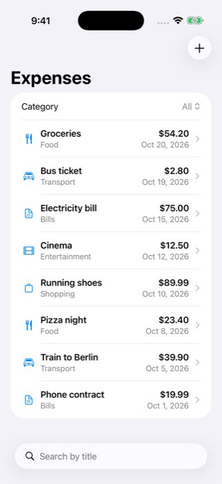

# swiftui-expense-tracker

A small iOS expense tracker written in **Swift and SwiftUI** (iOS 17, MVVM, no third-party packages).

> **Please note**
> - **The backend is a mock.** The app talks to a tiny local Python server (`mock-server/server.py`)
>   that serves `mock-server/transactions.json` and keeps new items in memory only. There is no real backend.
> - **I could not run Xcode locally.** I develop on Windows without Xcode or Docker.
> - **The app was built and tested only in GitHub Actions**, on a macOS runner with an iPhone simulator.
>   The screenshot below was taken by that CI job.



*Screenshot taken by the CI job (iPhone simulator, data loaded from the mock server). The full-size PNG is in the `screenshot` artifact of each workflow run.*

## What the app does

1. **Transaction list**: loads expenses from a REST API (URLSession + async/await). Each row shows the title, category, amount and date.
2. **Detail screen**: tap a row to see all its fields.
3. **Filter and search**: a category picker ("All" or a single category) and a search field that matches the title.
4. **Add an expense**: a form (title, amount, category, date) that sends a `POST`. It checks the input
   (the title must not be empty and the amount must be a number greater than 0) and shows an error message.
5. **States**: a loading spinner, an empty state ("No expenses yet") and an error state with a **Retry** button.

## Architecture

```
ExpenseTracker/
├── App/ExpenseTrackerApp.swift        entry point, chooses which API to inject
├── Models/                            Transaction (Codable, Identifiable), NewTransaction, Category enum
├── Networking/
│   ├── TransactionAPI.swift           the protocol + APIError
│   ├── URLSessionTransactionAPI.swift real implementation (URLSession, async/await)
│   └── MockTransactionAPI.swift       in-memory implementation for tests, UI test and previews
├── ViewModels/TransactionListViewModel.swift
└── Views/                             TransactionListView, TransactionRowView, TransactionDetailView, AddTransactionView
ExpenseTrackerTests/                   unit tests (XCTest)
ExpenseTrackerUITests/                 one UI test
mock-server/                           the mock backend (Python standard library only)
project.yml                            XcodeGen spec; the .xcodeproj is generated, not committed
```

- **MVVM**: the views only display state and forward user actions. `TransactionListViewModel` holds the state
  (`@Published transactions`, `state`, `selectedCategory`, `searchText`), does the filtering/search and the
  input validation, and calls the API. It is `@MainActor`, so UI state always changes on the main thread.
- **Protocol for the API**: `TransactionAPI` has two methods, `fetchTransactions()` and `addTransaction(_:)`.
  The view model only knows this protocol, not URLSession.
- **Dependency injection**: the view model gets its API through `init(api:)`.
  - The app passes `URLSessionTransactionAPI(baseURL: http://localhost:3000)`.
  - Unit tests pass `MockTransactionAPI`, so they are fast and never use the network.
  - The UI test starts the app with the launch argument `-useMockAPI`, so it does not need a server.
- **API client tests** use `StubURLProtocol`, a `URLProtocol` subclass plugged into a `URLSession`.
  It returns fake HTTP responses, so the real `URLSessionTransactionAPI` code (request building, status check,
  JSON decoding) is tested without a real network.

Amounts are stored as `Double` and shown in USD to keep the code simple.
A production app would rather use `Decimal` and the user's currency.

## Tests

| File | What it checks |
| --- | --- |
| `TransactionListViewModelTests` (15 tests) | initial state, loading success, empty result, loading failure, retry, filter by category, newest-first sorting, case-insensitive search, search + filter combined, adding a transaction, validation errors (empty title, zero / negative / non-numeric amount, error messages), API failure while adding |
| `URLSessionTransactionAPITests` (4 tests) | decoding valid JSON, invalid JSON throws `decodingFailed`, HTTP 500 throws `badStatusCode`, `POST` request method / URL / header / JSON body |
| `ExpenseTrackerUITests` (1 test) | launches the app and checks that the list appears |

## How CI works (`.github/workflows/ios.yml`)

The workflow runs on `macos-latest` for every push and pull request (it can also be started by hand from the
Actions tab). It:

1. installs [XcodeGen](https://github.com/yonaskolb/XcodeGen) and generates `ExpenseTracker.xcodeproj` from `project.yml`,
2. picks an available iPhone simulator with `scripts/pick_simulator.py` (it reads `xcrun simctl list` so no
   device name or iOS version is hardcoded) and boots it,
3. runs `xcodebuild test` (build + unit tests + UI test),
4. starts the mock server, installs and launches the app, and takes a screenshot with `xcrun simctl io booted screenshot`,
5. uploads two artifacts: **test-results** (`TestResults.xcresult`, the xcodebuild log, the mock server log) and **screenshot**.

To run the tests: push a commit (or click **Run workflow** in the Actions tab), then open the run to see the
log and download the artifacts.
You can open `TestResults.xcresult` in Xcode on a Mac.

## Running it on a Mac (not tried by me)

```sh
brew install xcodegen
xcodegen generate
python3 mock-server/server.py      # in a second terminal
open ExpenseTracker.xcodeproj      # run the "ExpenseTracker" scheme on an iPhone simulator
```

The app uses `http://localhost:3000`, which only works in the simulator (it shares the Mac's network).

## What is real and what is mocked

| Real | Mocked |
| --- | --- |
| SwiftUI app, views, navigation, form validation | The backend: a local Python stub with sample JSON, data is kept in memory only |
| `URLSessionTransactionAPI` makes real HTTP requests (to the mock server) | `MockTransactionAPI` replaces the API in unit tests, the UI test and previews |
| JSON encoding/decoding, status code handling | `StubURLProtocol` fakes HTTP responses in the API client tests |
| Build and tests on an iPhone simulator in GitHub Actions | No real device and no App Store build (no code signing) |
